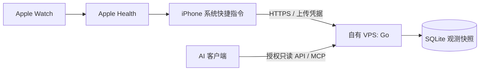

# Health Bridge

**Apple Health → 系统快捷指令 → 自有 VPS → ChatGPT / Grok / AI Agent。**

个人健康数据基础设施：苹果自带快捷指令负责采集，一个 Go 服务和 SQLite 数据库负责保存及查询。不要求 Apple 开发者年费、Xcode、自签 App 或周期续签；不通过第三方健康云中转。

> 当前是 **Shortcuts-first 设计基线**，尚无正式业务实现、可安装快捷指令包或在线端点。2026-10-25用户明确调整成本与维护约束，已撤销原生 App 默认路线。下一步先完成 iPhone 本地能力探针，不能把原生 HealthKit API 支持当作快捷指令已支持。

## 当前方案

- 有界窗口重读、服务器保存已接收观测快照、版本化每日统计。重复运行不重复累加同一窗口。
- 不要求快捷指令提供 HealthKit UUID、anchors、删除通知、原生后台 observer 或 SQLite outbox。
- 原样保留本次快捷指令输出的记录及重复数量；没有稳定身份的记录不冒充 HealthKit 原始样本。
- 上传与查询凭据独立，查询有 scope/日期/条数限制，MCP 不允许任意 SQL。
- 定时/训练结束自动化只是执行机会；锁屏、网络和系统限制仍会使一次运行失败。
- 原生 App 不在当前 Roadmap。字段不够时明确 unsupported/partial，不自动改回 App。

## 必须知道的降级

快捷指令的具体健康类型、字段、精度、来源与 UUID 暴露面尚待本人 iPhone 验证。删除事件、quantity series、完整游泳圈段/SWOLF不列为承诺；不能保证与 Apple Health 的数据或每日总量完全一致。重读窗口无法保证捕获所有历史修改。没有本地健康 outbox，网络失败后下一次重新读取，不能保证保住从未上传成功且后来在Apple端消失的记录。

**空读取不等于零，也不等于删除。** 当前窗口变为空只表示本次没有可见数据，旧观测仍保留供owner审计，不自动清除；AI默认收到null和缺失原因。

## 开始这里

1. [不装 Xcode 的能力探针](docs/shortcuts-probe.md)：首先只在iPhone本地检查字段，不上传健康值。
2. [HANDOFF](HANDOFF.md) / [AGENTS](AGENTS.md)：下一任务与开发护栏。
3. [Roadmap](docs/roadmap.md)：新阶段使用 **S01–S09**；原P01–P11已作废，不可继续执行。

| 文档 | 内容 |
|---|---|
| [调研](docs/research.md) / [复用](docs/reuse.md) | 五个指定项目的固定源码证据与当前复用范围 |
| [架构](docs/architecture.md) / [ADR](docs/decisions/README.md) | Shortcuts-first取舍与旧方案替代关系 |
| [采集与同步](docs/ios-sync.md) / [指标](docs/metrics.md) | 动作流程、能力门槛、窗口与字段限制 |
| [Schema](docs/data-schema.md) / [参考DDL](docs/schema.sql) | 观测快照而非假定UUID镜像 |
| [API/MCP](docs/api.md) / [OAuth](docs/oauth.md) | 上传与授权只读访问契约 |
| [聚合](docs/aggregation.md) / [安全](docs/security.md) | 快照选择、质量状态、来源、隐私 |
| [部署](docs/deployment.md) / [测试](docs/testing.md) / [审查](docs/review.md) | 运维与真实验收边界 |

现在可以运行 `python3 scripts/check_docs.py` 和 `git diff --check`，仅验证设计材料。没有运行Go业务、iPhone探针或MCP端到端测试。原创内容[MIT](LICENSE)，依赖与移植见[notices](THIRD_PARTY_NOTICES.md)。

完整JSON Schema检查在开发/CI的隔离Python环境安装`requirements-design.txt`后运行`python scripts/check_docs.py --full`；不是iPhone使用前提。
