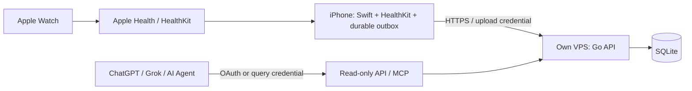

# Health Bridge

**把 Apple Health 数据同步到自己的 VPS，再按需、安全地提供给 AI。**

Health Bridge 是面向单个使用者的开源个人健康数据基础设施：极简 iPhone 客户端、一个 Go 进程、一个 SQLite 数据库。没有第三方健康云、广告 SDK、账号平台或任意 SQL 接口。

> 当前状态：**设计与文档基线，尚未实现业务功能，也没有可安装的发行版。** 文中的接口、配置及部署命令是后续开发契约，不代表现在可运行。调研核验日期：2026-10-25。



## 设计目标

- 保存授权范围内的原始 HealthKit 样本、来源、训练、睡眠阶段及删除事件；衍生每日汇总。
- 增量同步、历史回填、离线队列、重试与事务级幂等；失败可见，不静默丢样本。
- 训练心率、游泳事件、SWOLF、HRV、呼吸率、血氧、体重等有独立的数据质量说明。
- 上传、查询、管理权限隔离；MCP 只有固定只读工具。
- 自有 VPS 是唯一独立健康数据服务端。AI 只收到用户授权查询的结果。
- Linux amd64/arm64 单二进制部署；HTTPS 由同机 Caddy 提供；无需 Docker、PostgreSQL、Redis。

## 必须知道的边界

1. **选择原生 iOS App 为主采集端。** 快捷指令只用于触发同步，不承担可靠游标、删除或游泳明细同步。
2. 后台执行是 iOS 的机会性调度；锁屏、强制退出、权限变化都可能造成延迟。没有“每分钟必达”。
3. HealthKit 腕温是夜间绝对值；Apple Health 的个人基线偏移没有在本次调研中找到等价公开字段。两分钟心率恢复也没有对应的标准 HealthKit quantity type。衍生值会标明算法与缺失原因。
4. HealthKit 删除记录可能被清理，读取拒绝又不可辨识。长期离线后的完整删除恢复不能无条件保证；详见[同步设计](docs/ios-sync.md)。
5. ChatGPT 和 Grok 官方均已文档化自定义远程 MCP。**本项目尚未完成账号、设备或真实端点联调**，不能把文档支持当作已接通。
6. 本仓库无真实健康数据。演示与测试只允许人工构造的合成数据。

## 阅读顺序

| 文档 | 内容 |
|---|---|
| [HANDOFF.md](HANDOFF.md) / [AGENTS.md](AGENTS.md) | 当前状态、下一任务、Agent 护栏 |
| [源码调研](docs/research.md) / [复用决策](docs/reuse.md) | 五个候选、固定 SHA、代码证据、许可证 |
| [架构](docs/architecture.md) / [ADR](docs/decisions/README.md) | 模块边界与已冻结决策 |
| [iOS 同步](docs/ios-sync.md) / [指标矩阵](docs/metrics.md) | HealthKit、后台、单位、精度和设备限制 |
| [Schema](docs/data-schema.md) / [参考 DDL](docs/schema.sql) | 原始记录、删除、训练、汇总与迁移 |
| [API / MCP](docs/api.md) / [OAuth](docs/oauth.md) | 上传协议、查询工具、认证与客户端能力 |
| [聚合算法](docs/aggregation.md) | 来源去重、睡眠、心率恢复、游泳与时区 |
| [安全](docs/security.md) / [部署](docs/deployment.md) | 凭据、备份、恢复、升级与隐私边界 |
| [Roadmap](docs/roadmap.md) / [验证计划](docs/testing.md) | 小阶段交付与必过测试 |
| [架构自检](docs/review.md) | 设计审查、修正与未验证风险 |

## 当前可运行的检查

```sh
python3 scripts/check_docs.py
git diff --check
```

这些检查验证文档、合成示例和参考 SQL，不测试尚不存在的业务功能。Go、iOS、MCP 联调在各开发阶段建立。

## 开源与贡献

项目原创内容采用 [MIT](LICENSE)。本次未复制候选项目的业务代码。后续移植必须按 [reuse.md](docs/reuse.md) 保留原作者、许可证及修改记录；不得把 AGPL 代码改个名字放进 MIT 模块。见 [THIRD_PARTY_NOTICES.md](THIRD_PARTY_NOTICES.md)。

Health Bridge 提供数据基础设施与个人健康趋势信息，不实现诊断或医疗决策。
