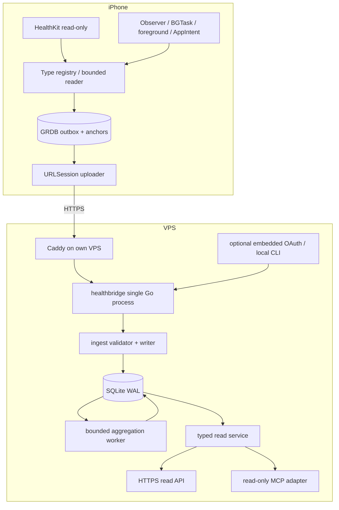

# 最终架构

状态：设计基线，2026-10-25。本文规定模块边界；同步状态机、字段和算法分别以 ios-sync、data-schema、api、aggregation 为准。

## 1. 范围与非目标

一个自然人、一个自有 VPS、一个主动上传 iPhone；Apple Watch 不运行自研 watchOS App。Watch 已采集的数据经 Apple 同步到 iPhone，客户端读取 iPhone HealthKit 可见记录。HealthKit 记录可来自多代 Watch、iPhone、体重秤或用户手工输入，必须保留 provenance。

不做医疗诊断、多人 SaaS、第三方可穿戴云接入、训练记录 App、实时心电、GPS 轨迹、FHIR、Web dashboard、向量检索或自主健康建议推送。新增类型必须先进入指标注册表和契约。

## 2. 部署组件

API / MCP 适配器仅接收 `QueryService`，不持有 writer；writer 不接受外部 SQL。读层通过单独 `mode=ro` 连接并设置 `query_only=ON`。同一进程并不提供 OS 级隔离，依靠固定查询、授权和测试降低风险；不声称能抵御主进程任意代码执行。

## 3. 服务端边界

| 目录（后续建立） | 责任 | 不允许 |
|---|---|---|
| `server/cmd/healthbridge` | serve / migrate / token / pair / backup / restore / export / delete / oauth 子命令 | HTTP 远程管理 shell |
| `server/internal/config` | 严格 JSON 配置，未知键/不安全绑定失败 | token 写进普通配置 |
| `server/internal/auth` | 上传/查询凭据，范围/期限/撤销，publisher fence | 以设备声明决定权限 |
| `server/internal/store` | SQLite、事务、参数化 SQL、迁移 | 通用 ORM、远程 DB |
| `server/internal/ingest` | 验证整个 batch、receipt、序列、tombstone、dirty queue | 部分成功 ACK |
| `server/internal/aggregate` | 可重建投影、版本化算法、源选择 | 覆盖原始记录 |
| `server/internal/query` | 固定 DTO、范围/分页/数据质量 | 任意 SQL/任意指标名 |
| `server/internal/httpapi` | 认证、限额、契约响应 | 输出内部错误/样本到日志 |
| `server/internal/mcp` | 官方 SDK 工具封装与 metadata | 与 REST 不同的授权逻辑 |
| `server/internal/oauth` | Fosite 适配、单 owner consent、持久凭据 | 密码登录/公有注册/自制 OAuth 协议 |
| `server/internal/admin` | 本地 Unix socket / CLI 操作 | 无认证网络端口 |

Go 标准库负责路由、JSON、TLS 后端连接语义、hash、随机数、日志。SQLite driver、MCP SDK、OAuth 库是明确的依赖例外；iOS 使用 GRDB 管理事务。配置用 JSON，不引入 YAML 解析库。

## 4. 为什么 Go + SQLite

单人批量写入、原始记录按时间索引、汇总查询的工作负载适合 SQLite；WAL 支持读写并行但仍只有一个 writer。采用一个写连接、最多 4 个读连接、短事务、批次 500 条、离线重试；不会把“SQLite”当成无限并发数据库。[SQLite 适用场景](https://sqlite.org/whentouse.html)、[WAL](https://sqlite.org/wal.html)。

数据库必须位于 VPS 本地文件系统，不放 NFS/SMB。`foreign_keys=ON`、`journal_mode=WAL`、`synchronous=FULL`、`busy_timeout=5000`，每个连接初始化相关 pragma。聚合写入走同一 writer queue，前台 ingest 优先，队列满返回 503。服务仅一实例，启动持有进程锁；不做多副本共享 SQLite。

容量是待测预算：1 vCPU/1 GiB RAM 是首轮测试目标，不是最低性能承诺；按 1000 万合成样本压测，记录磁盘 bytes/record、p95 ingest、查询与 WAL 增长。参考目标：500 条提交 p95 < 2 秒、31 天汇总 p95 < 1 秒、RSS < 256 MiB（不含 OS cache），测试环境必须注明。达到瓶颈先修索引和事务，不自动迁移 PostgreSQL。

## 5. 数据分层与一致性

- 原始层：HealthKit UUID、规范单位转换后的 Float64、原始语义、时间、source/device、选定 metadata、quantity series、workout 事件。不是传感器底层原始波形；HealthKit 已处理/合并的数据无法还原。
- 事实控制层：tombstones、publisher epoch、stream checkpoint、batch receipts、restore generation。删除先行且永久抑制旧 UUID。
- 投影层：daily metrics / sleep sessions / workout details / recovery；可重建、有算法版本。原始写入与 dirty 标记同一事务，计算在提交后进行。
- 质量层：query succeeded、no visible data、blocked、historical range、series pending、reconciliation required。没有能证明“用户没授权”的布尔 read permission。

同步保证：**在 HealthKit 当前可见、数据可读取、outbox 可持久化、网络最终恢复的前提下，at-least-once 传输 + 幂等提交**。server ACK 不等于聚合已重算；响应给出 projection 状态。不使用 exactly-once 或无条件完整备份宣传。

## 6. 数据流

1. 用户本地 CLI 生成一次性 pairing code；iPhone 验证 VPS HTTPS 域名并兑换仅上传凭据。
2. 用户在系统授权页选择读取类型。客户端逐类型 anchored page，完整序列化，事务保存 outbox 和 read anchor。
3. Uploader 发送同一批次的稳定字节；服务器验证后原子入库；ACK 含 digest/epoch/seq。
4. iPhone 事务推进 ack anchor 并删掉已确认队列；失败保留并按类别退避。
5. 聚合 worker 消费 dirty days，按版本和来源政策重建，CAS 检查数据 revision，避免写回过期汇总。
6. 查询凭据按 scope、metrics、日期和最大点数限制返回；AI 不接触数据库、完整导出或原始 metadata。

## 7. 不做多上传者冲突算法

服务保存一个 active `publisher_id + epoch`。更换手机由本地管理命令撤销旧上传凭据并创建新 epoch；所有旧批次被拒。Watch/source 不是 publisher。新手机重新从 nil anchor 回填（服务器 UUID 去重），不是恢复旧手机的 opaque anchor。

重装、健康授权窗口变化、query predicate 改动、服务端灾难恢复都需要新的 stream generation。读 anchor 只属于当前 iPhone、类型、predicate、schema 和 destination identity。不得跨目标服务器复制。

## 8. 隐私与低维护

服务不主动调用 AI；没有 LLM API key 配置。DNS/ACME 仅用于域名和证书，不含健康数据。默认直接解析 VPS，不启用 TLS 终止在第三方的 CDN/tunnel。备份只在 VPS 或用户 Apple 设备上，默认加密且不云同步。详细威胁模型、删除和恢复流程见 security/deployment。
